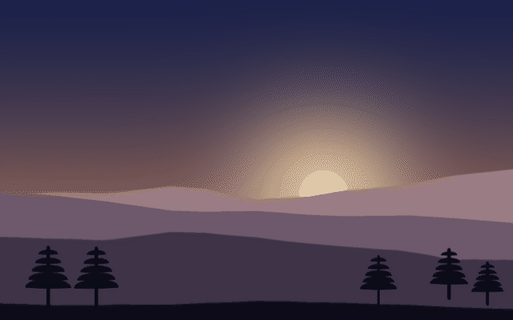
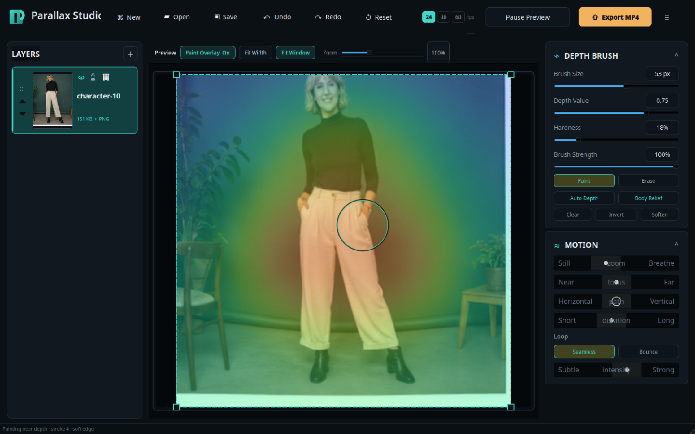

# Parallax Studio

**Turn a still image into a looping 2.5D parallax animation. Entirely on your own machine.**

Point it at a photo or a piece of layered art, press one button, and it works out what is near and what is far. Tune the motion, watch it loop live, export an MP4 or GIF. No account, no API key, nothing uploaded: the depth and pose models download once and then run on your own hardware.

### [Download for Windows, Linux and macOS](https://github.com/longweekendlabs/parallax-studio/releases/latest)

*One still image, no layers, no masking. Auto Depth worked out the hills and the tree line, and that is the loop it exports.*

## Depth without painting

**Auto Depth** runs Depth Anything V2 and separates a subject from its background properly. The result is feathered where it needs to be: a hard silhouette does not stretch under displacement, it tears, and the sampling grid folds back over itself along the outline. Feathering is what stops that. It works on anything: landscapes, rooms, objects, people.

## People move like people, not like cutouts

A picture of one person gets three motions of its own. Each finds the face first and moves the head and hair as one rigid piece, a turn and a shift but never a stretch, so the face stays exactly the face. The background stays still, whether the picture is a cut-out with transparency or a full scene.

**Portrait** is an idle loop. The head tilts and nods, the body turns slowly in depth around it, the hips sway and the chest lifts with each breath. Eight seconds a loop.

**Flaunt** swings the hips side to side while the shoulders lean the other way, tips the raised hip up and tilts the head toward it, with the chest moving on each step. Two swings in four seconds.

**Bounce** is a bounce on the spot with the feet on the ground. The body rises and falls, the legs bend instead of lifting off, and the chest follows a beat behind and travels further. Four bounces in six seconds.

Intensity, path and duration still tune them. Erase holds any area still while the rest moves, and Paint lets it move again.

## Or paint it yourself

A depth brush with size, hardness, strength and depth value, over a colour-ramped overlay that actually shows what you have painted. Blue is far, cyan sits on the neutral plane, red is near. Undo and redo throughout.

## Motion you can judge before you commit

Focus, path, zoom, loop type, duration and intensity. The preview plays at 24, 30 or 60 fps and reports the rate it is really achieving, so what you judge is what you get. Controls a motion does not use are dimmed while it is on, so a slider never sits there doing nothing.

## Export that uses your hardware

MP4 or GIF, at whatever resolution and frame rate you pick. On an NVIDIA machine it will use the GPU for rendering and NVENC for encoding once you enable them in Settings; the output is identical either way.

## The models run offline and stay out of your way

Downloaded on first use and kept afterwards, around 75 MB in total. All Apache-2.0, so nothing here restricts what you do with the output.

| Model | Size | Job |
|---|---|---|
| Depth Anything V2 Small | 50 MB | Depth for every motion. Default |
| Depth Anything V2 Small, full precision | 99 MB | The same, when the half-precision build shows banding |
| MediaPipe Selfie Segmentation | 0.5 MB | Finding the person, so the background stays still |
| MoveNet Thunder | 25 MB | Finding the face, shoulders and hips |

A larger Depth Anything V2 Base, 389 MB, is offered as well, but it is CC-BY-NC-4.0 and labelled as such in the app: do not use its output commercially.

## Formats

Imports PNG, JPG, JPEG and WebP. Exports MP4 and GIF.

Projects save as `.parlx`, a JSON file holding layer order, transforms, motion settings and depth maps. Source images are referenced by path, so project files stay small.

## Download

Windows, Linux x86_64 and macOS Apple Silicon builds are on the [releases page](https://github.com/longweekendlabs/parallax-studio/releases/latest), and laid out by platform on the [project page](https://longweekendlabs.github.io/parallax-studio/). The Windows installer is per-user, so it never asks for administrator rights. macOS 12 or newer.

## Feedback

[Open an issue](https://github.com/longweekendlabs/parallax-studio/issues) for a bug or a request.

## License

MIT License. See [LICENSE](LICENSE). Free and open source: no licence key, no trial, no subscription.

© 2026 Long Weekend Labs

---

Made with ♥ by **[Long Weekend Labs](https://github.com/longweekendlabs)**
