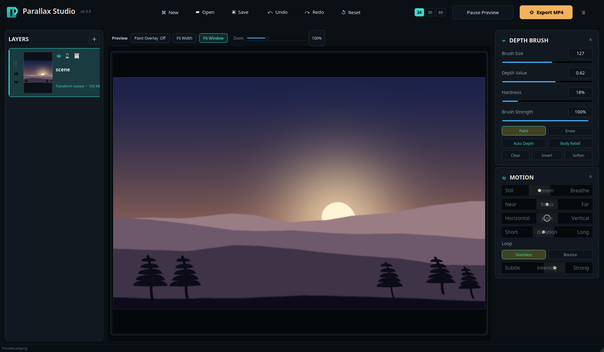

# Parallax Studio

**Turn a still image into a looping 2.5D parallax animation. Entirely on your own machine.**

[](https://github.com/longweekendlabs/parallax-studio/releases/latest)
[](LICENSE)
[](#download)
[](#depth-without-painting)



Point it at a photo or a piece of layered art, press one button, and it works out what is near and what is far. Tune the motion, watch it loop live, export an MP4 or GIF.

No account, no API key, nothing uploaded. The depth and pose models download once and then run on your own hardware.

---

## Download

### **[Get the latest release →](https://github.com/longweekendlabs/parallax-studio/releases/latest)**

| Platform | Package |
|---|---|
| **Windows** 64-bit | Installer `.exe`, or portable `.zip` |
| **Linux** x86_64 | `.rpm` for Fedora and RHEL, `.deb` for Debian and Ubuntu, or a portable `.tar.gz` |
| **macOS** Apple Silicon | `.dmg`, or `.zip` app bundle. macOS 12 or newer |

The Windows installer is per-user, so it never asks for administrator rights.

Every download is also laid out by platform on the **[project page](https://longweekendlabs.github.io/parallax-studio/)**.

---

## What it does

### Depth without painting

Two buttons generate depth for you.

**Auto Depth** runs Depth Anything V2 and separates a subject from its background properly. The result is feathered where it needs to be: a hard silhouette does not stretch under displacement, it tears, and the sampling grid folds back over itself along the outline. Feathering is what stops that.

**Body Relief** is for photographs of people. It finds every figure in the frame and its pose, then rebuilds the depth *inside* each one, so chest, waist, hips, arms and legs each carry their own parallax instead of the whole figure sliding about as a single cutout. It touches the subject only, leaving backgrounds and faces exactly as Auto Depth had them.

### Or paint it yourself

A depth brush with size, hardness, strength and depth value, over a colour-ramped overlay that actually shows what you have painted. Blue is far, cyan sits on the neutral plane, red is near. Undo and redo throughout.

### Motion you can judge before you commit

Focus, path, zoom, loop type, duration and intensity. The preview plays at 24, 30 or 60 fps and reports the rate it is really achieving, so what you judge is what you get. Body Relief also sets the motion controls to suit the depth it just generated, worked out from the scene rather than fixed defaults.

### Export

MP4 or GIF, at whatever resolution and frame rate you pick. On an NVIDIA machine it will use the GPU for rendering and NVENC for encoding once you enable them in Settings; the output is identical either way.

---

## The models

Downloaded on first use and kept afterwards, around 70 MB in total. All Apache-2.0, so nothing here restricts what you do with the output.

| Model | Size | Job |
|---|---|---|
| Depth Anything V2 Small | 50 MB | Auto Depth |
| MediaPipe Selfie Segmentation | 0.5 MB | Finding the subject |
| MoveNet MultiPose | 19 MB | Up to six figures. Default |
| MoveNet Thunder | 25 MB | One figure, more precise joints |
| MoveNet Lightning | 9 MB | One figure, fastest |

The pose model is selectable in Settings, as is how far Body Relief separates the parts.

A larger Depth Anything V2 Base is offered as well, but it is CC-BY-NC-4.0 and labelled as such in the app: do not use its output commercially.

---

## Formats

Imports PNG, JPG, JPEG and WebP. Exports MP4 and GIF.

Projects save as `.parlx`, a JSON file holding layer order, transforms, motion settings and depth maps. Source images are referenced by path, so project files stay small.

---

## Building from source

Requires Python 3.11 to 3.13.

```bash
git clone https://github.com/longweekendlabs/parallax-studio.git
cd parallax-studio
python3 -m venv .venv && source .venv/bin/activate
pip install -r requirements.txt
python main.py
```

Packaging: `build_rpm.sh` and `build_linux.sh` on Linux, `build_macos.sh` on macOS, `parallax_studio_windows.spec` with PyInstaller on Windows. Release builds for all three platforms come from `.github/workflows/release.yml`.

---

## License

MIT. See [LICENSE](LICENSE).

Made with ♥ by **[Long Weekend Labs](https://github.com/longweekendlabs)**
